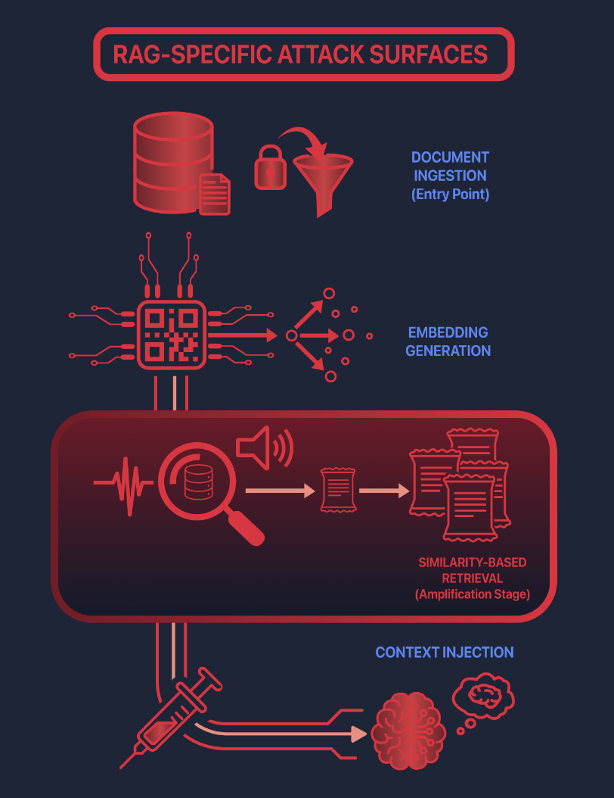

# RAG Security Fundamentals

---

  

Retrieval-Augmented Generation (RAG) enables Large Language Models (LLMs) to retrieve external documents and use them as additional context 
when generating responses. Unlike systems relying exclusively on training data, RAG retrieves relevant information during inference. Although 
this can improve accuracy and information freshness, it introduces additional trust boundaries and security risks.

A typical RAG architecture consists of four components. The Embedding Model converts user queries and documents into numerical vectors. The 
Vector Store maintains document embeddings for similarity comparisons. The Retriever identifies relevant documents using semantic similarity 
rather than exact keyword matching. Finally, the LLM generates a response using the retrieved documents as context.

The retrieval workflow begins when a user submits a query. The query is converted into an embedding, which the vector store compares against 
stored document embeddings. The highest-ranking documents are retrieved and injected into the LLM's context window before response generation. 
The model does not independently verify whether the retrieved information is accurate, safe, or trustworthy.

RAG security risks concentrate around document ingestion, embedding generation, similarity-based retrieval, and context injection. Documents 
originating from shared drives, wikis, and automated feeds may contain untrusted, outdated, or malicious information. During embedding 
generation, contextual details such as authorship and approval status are lost, potentially making legitimate and malicious documents appear 
equally valid. Retrieval then prioritises semantic relevance rather than correctness, trustworthiness, or intent. Finally, retrieved documents 
enter the model's context, where instruction-like content can influence generation.

Retrieval represents a particularly critical security boundary because it operates automatically and is generally invisible to users. The model
cannot independently establish document provenance, verify intent, inspect retrieval rankings, or reliably distinguish instructions from data.
Consequently, retrieved content can influence responses simply because it occupies the model's context window.

Retrieval abuse occurs when unintended or malicious documents influence generated responses through the retrieval process. Unlike traditional 
prompt injection, this technique does not necessarily require direct interaction with the model's prompt. Passive poisoning involves introducing
malicious content into the knowledge base and allowing ordinary queries to retrieve it. Active manipulation involves deliberately creating 
content designed to rank highly for common or sensitive queries. Neither approach necessarily requires continuous attacker access.

Context manipulation becomes possible when retrieved documents contain false information or concealed instructions presented as legitimate 
documentation. Because retrieval evaluates semantic relevance rather than intent or safety, these documents may enter the generation context. 
The model cannot reliably distinguish malicious instructions from ordinary information, and their placement can make them appear authoritative 
despite the absence of verification.

These attacks are difficult to detect because generated responses may remain logical, structured, and convincing. There may be no visible 
prompt injection, while system logs simply indicate that relevant documents were retrieved. Attackers can consequently influence responses, 
indirectly override system intent, and introduce misinformation or unsafe guidance without modifying the original prompt.

Three failure scenarios illustrate these risks. The first concerns Microsoft 365 Copilot and email-based retrieval abuse, described in the 
material as a 2026 incident. Emails containing embedded instructions were treated as valid ingestion sources, and retrieved content entered the 
model's context. The system could not distinguish legitimate information from embedded instructions or misleading guidance. The reported 
consequences included exposure of sensitive enterprise information, restrictions on Copilot access, and security guidance and mitigations from 
Microsoft.

The second scenario concerns ChatGPT Plugins in 2023. Plugins enabled retrieval from external services, including websites and third-party APIs.
Retrieved content containing instruction-like text influenced model behaviour without requiring modifications to system prompts or model 
parameters. The material identifies missing content-intent validation, inadequate separation between instructions and data, and an expanded 
trust boundary as contributing factors. Reported consequences included manipulated outputs, temporary disabling of plugin features, and 
subsequent redesign of retrieval and plugin security models.

The third scenario involves web-connected AI assistants returning outdated or incorrect guidance. These failures did not necessarily involve 
attackers. Documents remained indexed after their original sources changed, while retrieval prioritised semantic relevance over freshness. 
Without document lifecycle management, version validation, and freshness controls, outdated information continued influencing responses 
presented as current. This created operational and compliance risks while reducing confidence in AI-generated information.

RAG failures are particularly dangerous because misleading responses can appear authoritative and well-written. Users may trust the generated 
information despite the absence of visible injection or obvious system errors. A system can therefore operate according to its intended design 
while still producing harmful outcomes.

Defending RAG systems requires multiple overlapping controls. Retrieved content guardrails can limit how documents enter prompts, separate 
retrieved information from system instructions, and apply heuristics to identify instruction-like patterns. However, ambiguous language and 
deliberate obfuscation can bypass simple detection mechanisms. These safeguards reduce exposure but cannot guarantee safety.

Ingestion validation provides an opportunity to prevent malicious information from entering the knowledge base. Reviewing document sources, 
enforcing approval workflows, and maintaining ownership and update histories help establish control over incoming information. Once untrusted 
content enters the vector store, identifying and removing its influence becomes considerably more difficult and resource-intensive.

Monitoring must continue even when ingestion validation and guardrails are implemented. Useful behavioural indicators include unusual retrieval
patterns, repeated retrieval of particular documents, and gradual changes in response tone or behaviour. These gradual changes are known as 
output drift. Output drift can indicate that malicious or misleading information is progressively influencing generated responses rather than 
causing an immediate, obvious failure. Regular behavioural reviews help identify long-term deviations that automated controls may overlook.

Effective RAG security ultimately depends on defence-in-depth. No individual safeguard provides complete protection. Multiple controls must work
together to reduce the likelihood of successful attacks, limit the consequences of failures, and identify problems early.

The framework perspective connects these risks to established AI security approaches. The OWASP Top 10 for LLM Applications identifies indirect
prompt injection under LLM01, Data and Model Poisoning under LLM04, and Insecure Model Monitoring under LLM07. The NIST AI Risk Management 
Framework provides three relevant activities: Map, Measure, and Manage. These involve identifying dependencies on internal and external 
knowledge sources, evaluating the influence of retrieved information on outputs, and applying safeguards across ingestion, retrieval, and 
monitoring. The EU AI Act is also referenced through Article 9, concerning risk management, and Article 10, concerning data governance, quality,
and lifecycle management.

RAG changes the security assumptions surrounding AI systems because external information directly influences model behaviour during inference. 
Retrieval must therefore be treated as a security boundary rather than merely a performance optimisation. Indirect prompt injection, 
inference-time data poisoning, stale information, and context manipulation demonstrate how failures can originate from the data pipeline without
directly compromising the model itself.

## **Key Takeaways**

- **RAG architecture and workflow:** The user submits a query, the embedding model converts it into a vector, the vector store identifies
  similar document embeddings, the retriever selects matching documents, retrieved content enters the LLM's context, and the model generates a
  response.
- **Primary attack surfaces:** Document ingestion, embedding generation, similarity-based retrieval, and context injection.
- **Retrieval abuse:** Passive poisoning introduces malicious documents and waits for normal queries to retrieve them. Active manipulation
  deliberately creates content designed to rank highly for targeted queries.
- **Context manipulation:** Misleading information and concealed instructions can influence model responses without modifying the original
  prompt.
- **Detection challenges:** Convincing outputs, invisible injection, and ordinary retrieval logs make malicious influence difficult to
  identify.
- **Ingestion safeguards:** Review document sources, enforce approval workflows, and track ownership and update history.
- **Retrieved-content guardrails:** Limit retrieved text insertion, separate data from system instructions, and use heuristics to flag
  instruction-like patterns.
- **Behavioural monitoring:** Watch for unusual retrieval patterns, repeated document retrieval, and gradual response changes. Investigate
  output drift as a potential indicator of poisoning.
- **Layered defence:** Combine safeguards to reduce attack likelihood, limit potential impact, and detect failures early.
- **Security framework alignment:**
  - OWASP LLM01 – Indirect Prompt Injection.
  - OWASP LLM04 – Data and Model Poisoning.
  - OWASP LLM07 – Insecure Model Monitoring.
  - NIST AI Risk Management Framework – Map, Measure, and Manage.
  - EU AI Act Article 9 – Risk management.
  - EU AI Act Article 10 – Data governance, quality, and lifecycle management.
 
---

